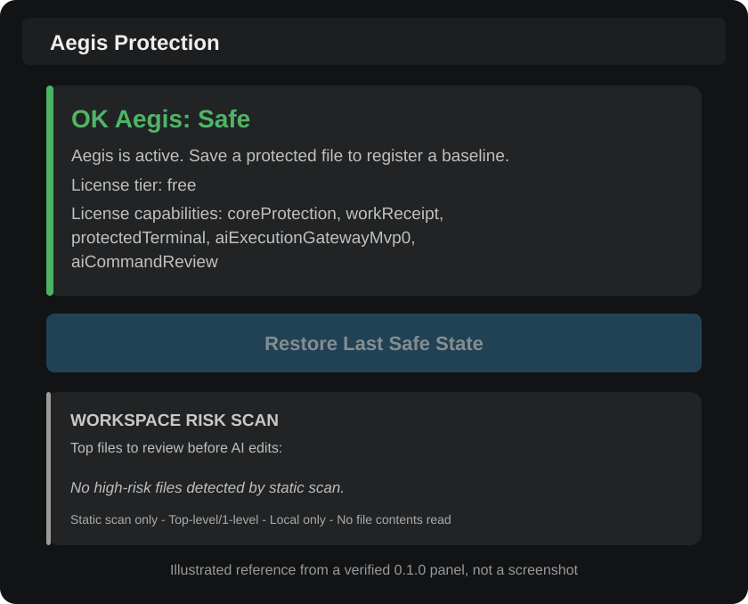

# AEGIS Trust — getting started

**Who this is for:** a developer installing AEGIS Trust for the first time. **What you will accomplish:** install the extension, open its actual protection panel, understand its messages, then make and restore a fictional file in a disposable workspace.

Estimated time: **3 minutes** to open the panel; approximately **10 minutes** for the optional hands-on exercise. Times are guides, not guarantees.

## Step 1 — install and open a safe practice folder

1. Open the [AEGIS Trust Marketplace page](https://marketplace.visualstudio.com/items?itemName=prolixotech.aegis-trust) and select **Install**, or search for **AEGIS Trust** by **ProlixoTech Inc.** in VS Code's Extensions view.
2. In the Extensions view, confirm the identifier **`prolixotech.aegis-trust`** and version **`0.1.0`**.
3. On your computer, create an **empty folder you can discard after practice**. Do not use your employer's repository or a folder containing real passwords.
4. In VS Code, choose **File > Open Folder…** and open your new folder.
5. If VS Code shows **Restricted Mode**, trust **only this folder that you created**. AEGIS intentionally disables operations in untrusted workspaces.

## Step 2 — open AEGIS Protection

1. Open the Command Palette: **Cmd+Shift+P** on macOS, or **Ctrl+Shift+P** on Windows/Linux.
2. Type **`Aegis: Show Protection Panel`**, select that command and press **Enter**.
3. Look for the tab **Aegis Protection** and a state card. In a fresh trusted folder you may see **`OK Aegis: Safe`**.

### Panel guide



*Illustrated reference based on an observed installed AEGIS Trust 0.1.0 panel, not an unedited screenshot.*

| What you see | What it means | What to do |
| --- | --- | --- |
| **OK Aegis: Safe** | AEGIS's **local** workflow state. It is not a statement about the security of the entire project or computer. | Read the status text. Do not assume protected baselines already exist. |
| **Restore Last Safe State** (possibly disabled) | Recovery is offered only when the current supported state permits it. A fresh folder usually has nothing to restore. | Leave it alone until you have deliberately created a fictional test baseline. |
| **WORKSPACE RISK SCAN** | Looks at names of a few common project files; it does **not** read their contents. | Review highlighted names yourself. “No high-risk files detected” is not a security audit. |
| A `.aegis` folder in Explorer | Local AEGIS state may be created in the workspace. Snapshots can include sensitive contents in real projects. | Keep `.aegis/` private and excluded from Git. |

## The 10-minute practice exercise

This optional exercise uses **only fictional values** in the empty folder you created. It shows the file-protection path; it is not a production recovery test.

### A. Register a first clean state

1. In VS Code's Explorer, click **New File**. Name it **`.env`** (with the leading dot).
2. Type exactly this fictional line:

```dotenv
AEGIS_DEMO_VALUE=first_fake_value
```

3. Press **Cmd+S** (macOS) or **Ctrl+S** (Windows/Linux) to save it.
4. Reopen **Aegis: Show Protection Panel** if needed. For a normal first nonempty save in a trusted workspace, AEGIS's current save handling registers a local baseline. An informational message can say **`Aegis: .env baseline registered. Protected from now on.`**
5. You may see a newly created **`.aegis/`** folder. It contains local protection state: it is **not** an online backup. Avoid opening or sharing its contents.

**If no baseline notification appears:** do not assume a snapshot exists. With only this fictional file in the disposable folder, choose **`Aegis: Register Current Clean Baseline`** in the Command Palette. The confirmation asks **`Register current protected files as the clean baseline?`** and offers **Register Clean Baseline**. This command considers **all present registered protected targets**, not just the active file, so use it **only** in your practice folder. An existing registered baseline is not overwritten by this command.

### B. See the effect of changing a protected file

1. Change the fictional line to:

```dotenv
AEGIS_DEMO_VALUE=second_fake_value
```

2. Save again and inspect the **Aegis Protection** panel.
3. For a previously registered, valid baseline, the extension's save handler marks the protected-file change **Blocked** and reports that a restore may be available. The exact on-screen message depends on the snapshot and workspace state.

**What “Blocked” means here:** AEGIS has detected a change within its protected-file workflow; it does **not** mean it prevented an external process from changing the file.

### C. Try restore — disposable folder only

1. Continue **only** if this is the practice folder and `.env` contains no real credentials. Restoration can **overwrite files** and can process **all eligible registered protected targets**, not just the file currently open.
2. If the **Restore Last Safe State** button is enabled, click it. If disabled, stop this exercise and see the FAQ; do not force recovery.
3. Check the actual `.env` contents **after** the operation. If restoration succeeds against the original practice baseline, it should contain **`AEGIS_DEMO_VALUE=first_fake_value`** again.
4. Confirm the extension reports the appropriate status. If restoration fails or the file differs, record the message and [report a bug](https://github.com/ProlixoTech/aegis-trust/issues) **without sharing secrets**.

### D. Optional: see a command review without executing anything

1. Open **Cmd/Ctrl+Shift+P** and select **`Aegis: Review AI Command / Action`**.
2. If no text is selected, AEGIS presents an input box labeled **`Paste or type the AI-generated command or action to review`**. Paste this harmless sample text:

```text
echo AEGIS_DEMO_ONLY
```

3. Press Enter to request a review. Inspect any result document and copied summary. The review is **not automatic command execution**.
4. Do **not** use unfamiliar commands, sensitive clipboard contents, or production files for this exercise.

## Before using AEGIS in real work

- Keep independent, tested backups. Do not use AEGIS as your only recovery system.
- Confirm that the file is one of the [registered protected targets](USAGE-EXAMPLES.md#what-files-are-in-scope). Not every source file or folder is protected.
- Ordinary terminals, other extensions and unintegrated AI agents are outside universal interception claims.
- Local `.aegis/` state may include complete file snapshots. Never commit it to Git or share it with a bug report.
- There is no live ProlixoTech-managed remote ruleset-update service in version 0.1.0.

**Next:** [Everyday examples](USAGE-EXAMPLES.md) · [FAQ and fixes](FAQ.md) · [Security model](SECURITY-MODEL.md) · [Back to product introduction](../README.md)

